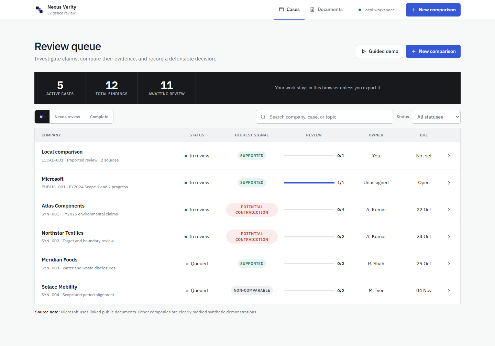

# Nexus Verity

Evidence-linked ESG contradiction analysis and assurance review workspace.

Nexus Verity compares sustainability claims with regulatory filings and other public evidence, verifies whether passages are materially comparable, highlights potential conflicts, and preserves the exact source text for human review. It never labels an organization deceptive or fraudulent.



## Features

- Focused review queue with status scopes, search, ownership, progress, and due dates
- One public Microsoft example plus four clearly labelled synthetic demonstration cases
- Persistent finding rail, side-by-side source excerpts, and a dedicated decision inspector
- Comparability gates for metric, period, scope, unit, boundary, and certainty
- Contradiction, support, uncertainty, non-comparable, and missing-evidence states
- Human decisions, rationales, timestamps, filters, and local persistence
- Searchable document library and structured JSON exports
- Multi-source TXT and text-based PDF ingestion; documents are not uploaded by the application
- Page-accurate citations retained from uploaded PDFs
- Audit-ready PDF reports, CSV evidence registers, and complete JSON exports
- Four-step guided demo for a fast product walkthrough
- Keyboard shortcuts for finding navigation, decisions, and saving
- Copyable evidence excerpts with citations and original-source links
- Visible focus, reduced-motion support, and semantic status labels
- Responsive evidence workflow with no horizontal overflow from 320 px phones through desktop

## Run locally

Requires Node.js 18 or newer.

```bash
npm start
```

Then open [http://127.0.0.1:4174](http://127.0.0.1:4174).

No dependency installation or build step is required.

## Test

```bash
npm test
```

The deterministic engine suite contains eight tests. The browser suite requires the Playwright development dependency and uses Microsoft Edge on Windows. Install development dependencies, keep the local server active, and run:

```bash
npm install
npm run test:browser
```

Release verification completed on 20 October 2026:

- Engine: 8/8 passed
- Browser workflow: 39/39 passed
- Combined: 47/47 passed

## Repository structure

```text
index.html                 Application shell
styles.css                Responsive design system
app.js                    Product state and interactions
engine.js                 Deterministic claim comparison engine
scripts/serve.mjs         Zero-dependency local server
tests/                    Engine and browser checks
docs/PRODUCT.md           Product contract and safety boundaries
docs/DESIGN.md            Design system and interaction direction
```

## Safety and privacy

- The Microsoft example uses linked public documents. All other company names, documents, and findings are synthetic.
- A “potential contradiction” is a screening signal, not a legal or misconduct conclusion.
- Imported documents remain in the browser session for this prototype.
- Scanned PDFs require OCR outside the current release.
- Published accuracy claims require a blinded, human-labelled real-report corpus.

## Research basis

The methodology draws on recent peer-reviewed ESG and claim-verification research, including CLARIESG, A3CG, ML-Promise, ESG-CID, ClimateCheck, UnifEE, and FEVER. Product controls and safety boundaries are documented in `docs/PRODUCT.md`.

## License

MIT. See [LICENSE](LICENSE).
